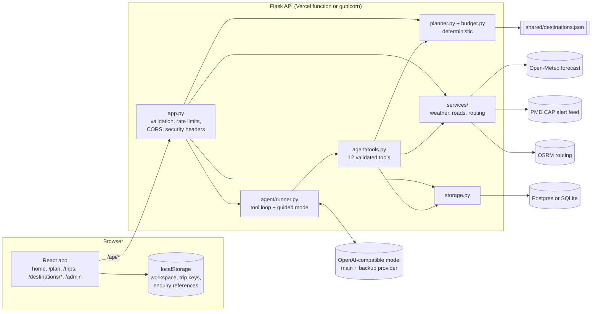
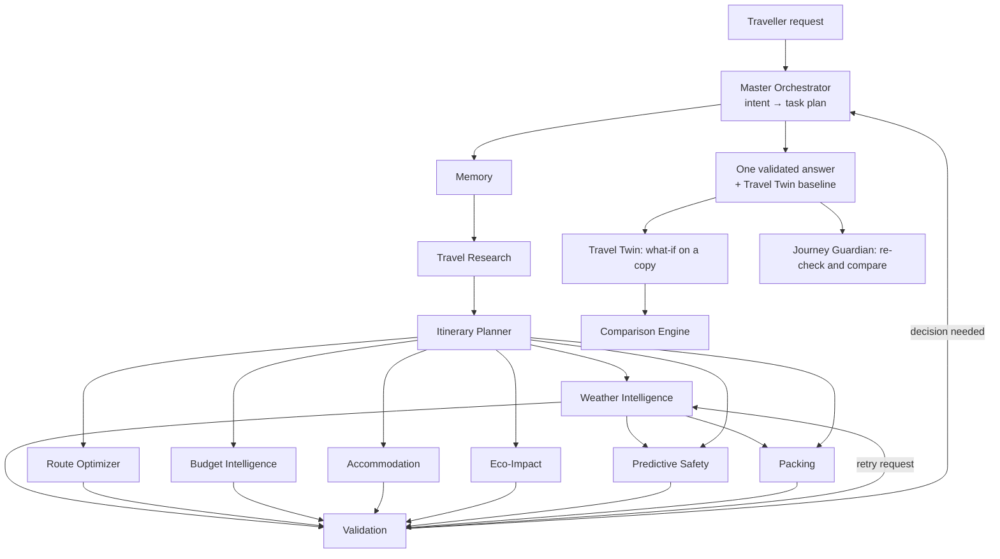

# How Raahi works

Raahi plans trips to Northern Pakistan (Gilgit-Baltistan and the Karakoram Highway). A
deterministic planner does the arithmetic (route, days, times, costs). A tool-calling AI
agent talks to the traveller and uses the planner and the live sources as tools. When no AI
model is available, a rule-based "guided" mode uses the same tools. On top of these, a
multi-agent system (section 11) splits a trip into specialist jobs, runs them in parallel,
validates them against each other, simulates what-if scenarios (Travel Twin) and scores each
day's risk (Journey Guardian). The rule throughout:
facts come from code, data files or live sources with a timestamp, never from the model's
memory, and anything that could not be checked is labelled as such.

## 1. Overview



| Folder | What is in it |
|---|---|
| `src/` | React 18 + Vite + Tailwind front end. `pages/`, `components/{home,planner,shared,layout,ui}`, `context/PlannerContext.jsx` (planner state), `lib/` (router, API client, local storage, formatting, SEO). |
| `backend/` | Flask API: `app.py` (routes), `agent/` (runner, tools, prompt, parser, guided mode, LLM client), `agents/` (the multi-agent system: orchestrator and specialists), `twin/` (Travel Twin scenarios, simulation, comparison), `guardian.py`, `planner.py`, `budget.py`, `schemas.py` (pydantic models), `storage.py`, `security.py`, `services/`, `tests/`. |
| `shared/destinations.json` | The one destination dataset used by the API and the website: places, hubs, road legs, seasonal routes, stays, cost assumptions, sources and review dates. Edit this file directly (it was first assembled from the old data files by `scripts/build_shared_data.py`); `backend/tests/test_data.py` checks it. |
| `api/index.py` | Vercel entry point that imports the Flask app. |
| `scripts/` | Image pipeline (`build_images.py`), static page prerendering (`prerender.mjs`), data builder. |
| `e2e/` | Browser tests (`run_e2e.py`) and the accessibility and page-weight audit (`audit.py`). |

## 2. The agent

### One chat message, step by step

1. **Validate** the request (`ChatRequest`: message up to 2,000 characters, at most 12 history
   turns of 1,500 characters reach the model, a structured `state`, an optional saved-trip reference).
2. **Read the message deterministically** (`agent/parser.py`): destinations, origin, days or
   "one day less", travellers ("3 of us", "2 adults and 2 kids"), budget and whether it is per
   person, dates or month, transport, stays, pace, interests, accessibility, food, guide. English
   and Roman Urdu. The result is merged into the **trip state** (`schemas.TripState`), so details
   are never asked twice and are kept across turns even if the model forgets.
3. **AI mode** (when a provider is configured): the model gets the system prompt
   (`agent/prompt.py`: how to work, honesty rules, safety, security, style) and a context block
   (Pakistan time and season, the trip state as JSON, what is still unknown, which values were
   assumed, a compact version of the current itinerary, and any changes made since it was
   built). It may call tools; each call is validated and executed by the server
   (`tools.execute`) and the result goes back to the model. The loop stops when the model
   answers or a limit is reached.
4. **Guided mode** (no provider, or the provider failed before any tool ran): `agent/guided.py`
   recognises the intent (plan, change, weather, road, route, cost, save, booking help,
   suggestions) and calls the same tools, then writes a plain answer from their results.
   The reply carries a notice saying it is guided mode.
5. **Respond** with the reply plus structured results taken from the tools themselves
   (itinerary, forecast, alerts, road status, route, budget, enquiry draft), the updated
   state, a trace of every tool call (name, arguments, ok or error, milliseconds), suggested
   next messages and the time taken. The website draws the plan from these structures, not
   from the model's prose.

### Tools

| Tool | What it does | Source |
|---|---|---|
| `search_destinations` | Suggests places for interests, a month, an altitude limit or no hiking | dataset |
| `get_destination_details` | Altitude, season, access, accessibility, highlights, indicative stays, sources | dataset |
| `get_weather_forecast` | Forecast up to 16 days with risks and confidence, plus official alerts | Open-Meteo, PMD |
| `get_route_information` | Curated distance and realistic drive time, OSRM free-flow figure, Maps link | dataset, OSRM |
| `get_road_status` | What can and cannot be known: always "not verified", with alerts, typical seasonal closures, optional unverified news, official checks | PMD, dataset, Tavily (optional) |
| `find_places` | Places to stay (curated, matched to a per-night range, plus OpenStreetMap listings without prices) or to eat (local dishes, restaurants and cafés) in a town | dataset, OpenStreetMap |
| `estimate_trip_budget` | Line-by-line PKR estimate compared with the budget, with savings | `budget.py` |
| `create_itinerary` | Builds the full day-by-day plan | `planner.py` |
| `update_itinerary` | Changes days, dates, budget, pace, transport, stays, destinations or one day, keeping everything else | `planner.py` |
| `save_trip` | Saves or updates the trip, only when asked. The private key goes to the browser, never to the model | `storage.py` |
| `get_saved_trip` | Reopens the trip open in this browser and rebuilds it with today's data | `storage.py` |
| `create_booking_enquiry` | Opens an enquiry **draft** in the website. It sends nothing; the traveller reviews it, ticks consent and sends it | none |

### Guard rails

| Limit | Default | Setting |
|---|---|---|
| Model turns per message | 6 | `AGENT_MAX_STEPS` |
| Tool calls per message | 10 | `AGENT_MAX_TOOL_CALLS` |
| Whole message deadline | 45 s | `AGENT_DEADLINE_S` |
| Model output per turn | 900 tokens | `LLM_MAX_TOKENS` |
| One tool result shown to the model | 6,000 characters (lists are shortened first) | `AGENT_TOOL_RESULT_CHARS` |
| Request body | 64 KB | `MAX_BODY_BYTES` |
| Chat requests | 12 per minute per visitor | `CHAT_RATE_PER_MIN` |

- Tool arguments are parsed with pydantic models; unknown tools and invalid arguments return
  an error to the model instead of running.
- Only the 12 tools above exist. None of them can fetch an arbitrary URL, run code, read files
  or send messages.
- A message sticks to one provider. If the main provider fails, the backup provider (and any
  fallback models) is tried; a 401 or 403 skips the rest of that provider's models.
- Saved-trip keys, enquiry keys and the admin token are never put in the model's context.
- **Facts are fetched by the server first.** Tested with a real model (gpt-oss-120b, 30 Oct
  2026), the model sometimes answered road questions from memory without calling a tool. So
  `runner.prefetch` now calls the tool itself before the model replies: road questions get
  `get_road_status`, weather questions the forecast for the places in the trip, and a new trip
  with a place and a length gets `create_itinerary`. The results go into the conversation as
  tool results, which also saves one model call per question.
- **Unsupported claims are rejected.** If the model's reply says a road is open or passable,
  or that something is booked, reserved or confirmed (outside a negation or a seasonal
  statement such as "usually open April–November"), the reply is discarded, guided mode
  answers instead, and the trace shows an `honesty_check` entry.
- The instructions also require replies in the traveller's own script (Roman Urdu stays in
  Latin letters), describing places only with the fields a tool returned (no invented
  amenities), and naming only official sources that tools give.

## 3. Planner (`backend/planner.py`)

- **Route**: shortest path (Dijkstra) over curated road legs between hubs (Islamabad, Chilas,
  Gilgit, Karimabad, Skardu, Sost…), using realistic hours, not map averages.
- **Days**: travel is split at towns where an overnight is sensible, with a cap of about 12.5
  hours on the road per day; short moves (under 4 hours) are merged into a sightseeing day.
- **Time of day**: departure times are worked out from the sunset for that date and place
  (NOAA formula) so the car arrives about 45 minutes before dark. Days that risk arriving
  after dark say so. With only a month known, mid-month daylight is used.
- **Feasibility**: minimum days for the route, recommended days per place, buffer days for
  long road trips, day trips (Deosai from Skardu, Khunjerab from Sost or Passu), Fairy Meadows
  and K2 templates (jeep, hike, permits, trek camps).
- **Checks**: seasonal closures (e.g. Deosai and Khunjerab in winter), out-of-season places,
  winter flight cancellations, monsoon landslides, altitude and accessibility warnings, a
  weather alternative for each sightseeing day.
- **Changes** (`apply_changes`) edit the request and rebuild, so every other preference stays.
  Edited or regenerated days are kept by their key (e.g. `hunza:1`).

## 4. Budget engine (`backend/budget.py`)

Every line has a category, a label, an amount, how it was worked out (unit cost × units),
how often it is paid (per trip, per day, per night, per person) and `status: "estimate"`.
It handles group versus per-person budgets, adults and children (children eat less, still
take seats), the number of rooms and vehicles needed, stay level, transport mode, park
entry fees and a 10% contingency. It compares the total with the traveller's budget
(within, tight, over), explains the gap, and suggests savings by rebuilding the plan with
cheaper options. Cost assumptions are in `shared/destinations.json → cost_model` with a
review date; none of them are live prices.

## 5. Weather and roads

- **Weather** (`services/weather.py`): Open-Meteo forecast for the destination's
  coordinates, up to 16 days ahead, with the time it was retrieved. Days more than 7 ahead
  are marked lower confidence; beyond 16 days the app says no forecast exists. The model's
  "current conditions" are labelled as a model value, not an observation. Rain, snow, heat
  and freezing risks become plan warnings with an alternative for that day.
- **Official alerts**: the PMD CAP feed (public RSS of weather warnings), filtered to
  alerts that mention the region and are still in force.
- **Roads** (`services/roads.py`): there is no public live feed for road status in
  Gilgit-Baltistan. The result is always `status: "not_verified"` with the headline
  "Current road status could not be verified.", plus official PMD alerts, the typical
  seasonal window for high routes (from the dataset, labelled typical), unverified news
  reports if Tavily is configured, an experimental model estimate if a KKH model is
  configured, and where to check: NHMP (helpline 130 and its travel advisory page), PMD and
  NDMA. A road is never called open because no closure was found.

## 6. Storage

Two tables, created automatically on first use (`metadata.create_all`, which only adds
missing tables). `python backend/storage.py init` creates them explicitly;
`python backend/storage.py sql` prints the SQL below.

```sql
CREATE TABLE trips (
  id VARCHAR(32) PRIMARY KEY,
  token_hash VARCHAR(64) NOT NULL,          -- SHA-256 of the private key
  title VARCHAR(160) NOT NULL,
  request_json TEXT NOT NULL,               -- the validated TripRequest
  itinerary_json TEXT NOT NULL,             -- the plan as shown when saved
  created_at TIMESTAMPTZ NOT NULL,
  updated_at TIMESTAMPTZ NOT NULL
);

CREATE TABLE enquiries (
  id VARCHAR(32) PRIMARY KEY,
  reference VARCHAR(16) NOT NULL UNIQUE,    -- e.g. RAH-7KQ2-M9XD (no 0/O or 1/I)
  token_hash VARCHAR(64) NOT NULL,
  trip_id VARCHAR(32) REFERENCES trips (id) ON DELETE SET NULL,
  name VARCHAR(80) NOT NULL,
  contact_method VARCHAR(16) NOT NULL,      -- email | phone | whatsapp
  contact_value VARCHAR(120) NOT NULL,
  message TEXT,
  request_json TEXT,
  summary VARCHAR(300),
  consent_text TEXT NOT NULL,               -- the exact wording agreed to
  consent_version VARCHAR(20) NOT NULL,
  consent_at TIMESTAMPTZ NOT NULL,
  status VARCHAR(16) NOT NULL,              -- new | in_review | contacted | closed | spam
  admin_note TEXT,
  created_at TIMESTAMPTZ NOT NULL,
  updated_at TIMESTAMPTZ NOT NULL
);
CREATE INDEX ix_enquiries_status_created ON enquiries (status, created_at);
```

- **No accounts.** Creating a trip or an enquiry returns a random private key once. Only its
  SHA-256 hash is stored; reading, changing or deleting needs the key (constant-time
  comparison). The browser keeps the keys in localStorage, so "My trips" works in that browser
  only. Anyone without the key gets "not found".
- **Enquiries** need the consent box ticked; the consent text and version are stored with
  the enquiry. The traveller can check the status or withdraw (delete) it with the key. Admins
  list and update enquiries with `ADMIN_TOKEN`. Enquiries are refused (503, "nothing was
  sent") unless both a database and `ADMIN_TOKEN` are configured.
- **Destinations are not in the database.** They live in `shared/destinations.json` so that
  changes are reviewed in git, carry sources and review dates, and the static pages can be
  built from the same file.
- **Migrations**: this is the first schema. `create_all` does not alter existing tables, so a
  future column change needs a migration tool (Alembic) or a hand-written `ALTER TABLE`.

## 7. API

All responses are JSON. Errors look like `{"error": {"code", "message", "details"}}`.

| Method and path | Purpose | Limit per minute |
|---|---|---|
| `GET /api/health` | Version, AI configured, storage, enquiries open, live services | none |
| `GET /api/destinations`, `GET /api/destinations/<id>` | Dataset | none |
| `GET /api/weather?destination=hunza&start=2026-11-06&days=7` | Forecast | 60 |
| `GET /api/alerts` | PMD alerts for the region | 60 |
| `GET /api/roads?destinations=hunza,skardu&date=2026-11-06` | Road information (always not verified) | 60 |
| `GET /api/route?from=islamabad&to=karimabad` | Route figures | 60 |
| `GET /api/places?town=hunza&kind=stay&min=5000&max=8000` | Places to stay (or `kind=food`) | 60 |
| `POST /api/chat` | One agent turn | 12 |
| `GET /api/agents` | The agent roster, their dependencies, and the agents planned for later | none |
| `POST /api/agents/run` | Run the orchestrator on `{"message"}` or `{"request"}` (optional `intent`, `memory`); `?stream=1` streams events | 20 |
| `GET /api/twin/scenarios` | Scenario presets and the road sections that can be closed | none |
| `POST /api/twin/simulate` | Run a what-if on a copy of `{"request"}` with `{"text"}` or a structured `{"scenario"}`; `?stream=1` streams | 20 |
| `POST /api/guardian/check` | Re-run weather, route and safety on `{"request"}`, compare with `{"previous"}`; `?stream=1` streams | 20 |
| `GET/PUT /api/trips/<id>/companion` | Safar Saathi settings of a saved trip (members, budget, first day, language, accepted changes) and its expenses (header `X-Trip-Token`) | 40 |
| `POST /api/trips/<id>/expenses/sync` | Upload `{"expenses": [...]}` made on the phone; returns the trip's full list (header `X-Trip-Token`) | 40 |
| `POST /api/companion/wording` | Optional AI rewording of a rule-based nudge; returns the template unless the numbers survive | 40 |
| `POST /api/plan` | Build a plan from a `TripRequest` | 40 |
| `POST /api/plan/update` | Apply changes to a request and rebuild | 40 |
| `POST /api/budget` | Budget only | 40 |
| `POST /api/conditions` | Forecasts and road information for a plan's days | 60 |
| `POST /api/trips`, `GET/PUT/DELETE /api/trips/<id>` | Saved trips (header `X-Trip-Token`) | 6 writes, 60 reads |
| `GET /api/enquiries/consent` | Current consent text and whether enquiries are open | none |
| `POST /api/enquiries`, `GET/DELETE /api/enquiries/<ref>` | Enquiries (header `X-Enquiry-Token`) | 6 writes, 60 reads |
| `GET /api/admin/enquiries`, `PATCH /api/admin/enquiries/<ref>` | Admin (header `Authorization: Bearer <ADMIN_TOKEN>`) | 60 |

Examples (local server on port 5000):

```bash
curl -s localhost:5000/api/health

curl -s -X POST localhost:5000/api/plan -H "Content-Type: application/json" -d '{
  "origin": "islamabad", "destinations": ["hunza", "attabad"], "start_date": "2026-11-06",
  "days": 7, "adults": 2, "budget_pkr": 150000, "budget_basis": "total",
  "transport": "car", "accommodation": "mid", "pace": "balanced"}'

curl -s -X POST localhost:5000/api/plan/update -H "Content-Type: application/json" -d '{
  "request": {"origin": "islamabad", "destinations": ["skardu"], "days": 6, "adults": 2},
  "changes": [{"op": "set", "field": "days", "value": 7}, {"op": "add_destination", "destination": "deosai"}]}'

curl -s -X POST localhost:5000/api/chat -H "Content-Type: application/json" -d '{
  "message": "Plan 6 days in Skardu from Islamabad for 2 people, budget 150000", "history": []}'
```

`/api/plan` returns `{"itinerary": {...}}` with `title`, `summary`, `feasibility`, `days`
(each with `date`, `moves` with departure and arrival times, `overnight`, `activities`,
`risks`, `weather_alternative`, `cost`, `sources`), `stays`, `budget`, `warnings`
(`level`, `code`, `message`), `sources`, `data_reviewed` and `generated_at`.

## 8. Security

- Secrets only in server environment variables; nothing secret is built into the website.
- Every request body is validated with pydantic (`extra="forbid"` where it matters); body size
  limit; per-visitor rate limits per bucket (in memory, per server instance).
- CORS limited to `ALLOWED_ORIGINS`; security headers on every response (also set by
  `vercel.json` for static files).
- Private keys hashed at rest; admin token compared in constant time.
- Enquiries: consent required, honeypot field against bots, the traveller can withdraw.
- Prompt injection: tool results and saved notes are marked as data in the prompt, the model
  can only use the 12 tools, arguments are validated, and anything consequential (sending an
  enquiry) needs the traveller to act in the website.
- Logs record method, path, status and timing, not request bodies or personal details.
- Assistant text is rendered with a small safe Markdown renderer (no HTML injection; only
  `http(s)` links).

## 9. Front end

- Routes: `/` (home), `/plan` (chat and plan side by side; Chat and Plan tabs on phones),
  `/trips` (saved trips and enquiries in this browser), `/destinations/<id>`, `/admin`,
  `/twin` (Travel Twin), `/agents` (Agent Control Center), `/guardian` (Journey Guardian),
  `/trip/new` and `/trip/<id>` (Safar Saathi, the trip companion).
- Money is written the Pakistani way everywhere: `Rs 1,50,000` (`src/lib/format.js` and
  `backend/money.py`).
- A service worker (`public/sw.js`, registered only in the built site) keeps the app usable
  offline: pages network-first with a cached fallback, hashed assets cache-first, API calls
  never cached.
- Themes: colours are CSS variables, so one set of Tailwind classes serves a light and a dark
  theme. The theme button cycles device, light and dark (`raahi:theme`). The agent pages use a
  dark "mission" look (`.mission`) whatever the theme.
  A small History-API router; pages other than home load on demand.
- `PlannerContext` keeps the conversation, trip state and itinerary in localStorage
  (`raahi:workspace:v2`), so a refresh does not lose the plan.
- `npm run build` also prerenders static HTML for each destination page (with JSON-LD),
  `sitemap.xml` and `robots.txt`, so the content can be crawled without JavaScript.
- Photos: responsive WebP sizes made by `scripts/build_images.py`; alt text, credits and
  focal points in `src/data/photos.meta.json`.

## 10. Tests

| Command | What it covers |
|---|---|
| `npm run test:api` | Backend unit and API tests with pytest (147 on 30 Oct 2026): data, planner, budget, services (with recorded PMD fixtures and fake HTTP), storage (SQLite; Postgres when `RAAHI_TEST_PG_URL` is set), API, parser, the agent with a scripted fake model (including the 10 evaluation scenarios), and the multi-agent system (`test_multiagent.py`: task graph, events, intent routing, failures, validation retries, every scenario type, comparison, risk and eco models, Guardian, streaming). All offline. |
| `npm run test:e2e` | 21 browser checks against a running server (Playwright + Chromium), including Travel Twin, Agent Control Center, Guardian and the theme button. |
| `npm run audit:a11y` | axe-core accessibility audit of 62 page states at phone and desktop sizes (including the agent pages and the dark theme), plus page weight. |

Tests use fakes for every external service; passing them shows the code handles those
responses, not that the live services or a real AI model behave the same way.

## 11. Multi-agent system

The multi-agent system reuses the planner, budget engine and live services above; the agents
are coordinators around them, not a second copy of the logic. Each agent is a Python class
with a name, a description and its dependencies (`backend/agents/`). Agents share a
`Blackboard` (the request, closures, scenario, results) and report to a `Tracer` that records
real events with timestamps. Nothing on the agent pages is animated from a script: every
status the website shows is an event the server recorded.



### Agents

| Agent | Depends on | Job | Tools it calls |
|---|---|---|---|
| Master Orchestrator | | Detects the intent, plans the tasks, runs them, handles retries and decisions, writes the answer | all of the below; optional LLM narration |
| Memory | | Reads the message into the trip state; uses saved preferences only with consent and only for the same trip | `agent/parser.py` |
| Travel Research | Memory (soft) | Season fit, nearby add-ons in the same cluster, alternatives | dataset |
| Itinerary Planner | Memory, Research (soft) | Day-by-day plan on the road network, respecting closures; a flight alternative when the road is too long | `planner.build` |
| Weather Intelligence | Itinerary | Forecast for each plan day, official alerts, impacts | Open-Meteo, PMD feed |
| Route Optimizer | Itinerary | Road sections used, drive hours, live routing cross-check on the longest drives, closures | dataset, OSRM |
| Budget Intelligence | Itinerary | Itemised estimate, budget status, the cheapest changes that fit | `budget.py`, `fit_to_budget` |
| Accommodation Research | Itinerary | Stays per overnight town within the per-night allowance | dataset, Overpass |
| Predictive Safety | Itinerary, Weather | Risk score per day with evidence (below) | risk model, road information |
| Packing Intelligence | Itinerary, Weather | Checklist with a reason for every item | rules on places, season, forecast, activities, scenario |
| Eco-Impact | Itinerary | Transport emissions as a range, for the plan and for coach, car and flight options | factor table (below) |
| Validation | every task that ran | Cross-checks the agents and decides: pass, retry, wait for a decision, or fail | `validation_agent.check` |
| Travel Twin | | Applies a scenario to a copy of the request | `twin/scenarios.py` |
| Comparison Engine | Itinerary | Original against simulated: days, cost, time, route, risk, emissions | `twin/comparison.py` |

Local Pulse (community reports) and Emergency Assistance are listed by `GET /api/agents` as
planned for phase B. They are not implemented, and the website says so.

### How a run executes

1. The orchestrator detects the intent (`plan`, `packing`, `safety`, `eco`, `budget`,
   `stays` or `research`) and activates only the agents that intent needs. A packing question
   runs Itinerary, Weather and Packing, not Budget or Eco.
2. The runner starts every agent whose dependencies have finished, in parallel threads. If a
   dependency failed, its dependents are marked `failed` with that reason, except for soft
   dependencies (Memory and Research), which a plan can do without.
3. Every agent call to a service or engine is recorded as a `tool` event with its duration and
   result. An agent that raises is marked `failed` with the error; the others still answer.
4. Validation checks: a plan exists; it fits the days; the budget agent agrees with the plan;
   forecast dates are plan dates; every day has a risk score and every point has evidence;
   packing uses the forecast when there is one; emissions list their assumptions; and no agent
   says a road is open, something is safe or guaranteed, or a booking is confirmed.
5. If Weather failed for a reason that may pass (the service could not be reached), Validation
   asks it to run once more. The retry asks the service again instead of reusing the briefly
   cached failure, and the trace shows the retry as initiated by the Validation task.
6. Choices that belong to the traveller (over budget, too few days) are returned as options
   with status `waiting_for_approval`. Choosing one re-runs the agents with that change.
7. With an AI key, one call turns the validated results into prose. The prose is used only if
   every amount of 1,000 or more from the deterministic text appears in it unchanged and it
   passes the same unsupported-claims check; otherwise the deterministic text is used and the
   trace says why.

Event types: `queued`, `running`, `tool`, `retrying`, `completed`, `failed`, `skipped`,
`waiting_for_approval`, `note`. With `?stream=1` the endpoints answer with NDJSON, one line
per event (`{"type": "event", ...}`) and a final `{"type": "result", "data": ...}`, so the
website can draw the workflow as it happens.

### Travel Twin

A scenario is parsed from English or Roman Urdu (`twin/scenarios.parse`) or sent as a
structured object. Supported types: `road_closed`, `heavy_snow`, `budget_change`,
`days_change`, `destination_closed`, `group_change`, `more_adventure`. Anything else is
refused with the list of supported scenarios.

`apply` builds a new request and never edits the original. For a closed road it closes the
road's legs from the given day (the planner then routes around them where another road
exists), drops places that can no longer be reached, and adds an in-season place from the
same area below 3,500 m if there is one. If the road from the origin itself is cut, it
switches to flights where they exist, or reports that there is no alternative instead of
inventing one. A budget cut runs `fit_to_budget` to find the cheapest changes that fit.
Snowfall is an assumption the traveller makes: it raises the risk of the affected days as a
`scenario` factor and adds a spare day, and the result says it is not a forecast.

The simulation rebuilds the original with the baseline agents, runs only the agents the
scenario affects (the rest are shown as "not affected"), validates, compares, and recommends
accepting or keeping. Its confidence comes from the scenario type: high for budget, days and
group changes and when the plan never uses the closed road or place, medium for other
closures and for more adventure, low for snowfall. The original stays unchanged until the
traveller presses "Accept this plan".

### Risk model (Predictive Safety and the Guardian)

Weights live in `shared/destinations.json` → `risk_model`, so they can be changed without
code. Each factor adds weight × intensity (0 to 1); a day's score is capped at 100.

| Factor | Weight | Evidence |
|---|---|---|
| Severe weather in the forecast | 30 | Open-Meteo: thunderstorms, 20 mm rain or 5 cm snow (full), 10 mm rain or any snow (0.6), −5 °C or colder (0.4) |
| Official PMD alert for the region | 25 | Active alert for the region: full if it names the place, 0.7 otherwise, 0.5 when the trip has no dates |
| Usually closed this month | 25 | A seasonal route reached that day is outside its typical open months |
| Travel Twin scenario | 30 | The traveller's own what-if (marked as an assumption) |
| Monsoon landslides | 10 | Road travel in July–August (full) or June and September (half) |
| Winter conditions | 10 | Road travel in December–February (full) or November and March (half) |
| Long mountain drive | 10 | 10 hours or more (full), 8 or more (0.6) |
| Arrival after dark | 10 | The daylight check says the drive may end after dark |
| High altitude | 10 | The highest place actually reached that day: 4,500 m or more (full), 3,500 m or more (0.6) |
| Community reports | 15 | Not used yet (Local Pulse is phase B) |

Categories: Low under 20, Moderate 20–39, High 40–59, Severe 60 and above, each with a
recommended action. Confidence is low without dates or a forecast and at most medium with
them, because no live road status exists. The score is a heuristic from public data, not an
official safety assessment.

The Guardian (`backend/guardian.py`, page `/guardian`) runs Itinerary, Weather, Route and
Safety for a saved trip, the current plan or the Travel Twin, and lists what changed since the
previous check in this browser (overall category, any day's category, new or ended alerts).
While the page is open it re-checks every 30 minutes and can show a browser notification if
the traveller allows it. It does not run in the background when the page is closed.

### Emission factors (Eco-Impact)

| Mode | Unit | Low | High | Basis |
|---|---|---|---|---|
| Hired car or 4×4 | kg CO2e per vehicle-km | 0.210 | 0.273 | Large diesel car (DESNZ 2025); up to 30% more on steep roads (Raahi assumption) |
| Coach | kg CO2e per passenger-km | 0.028 | 0.060 | Coach (DESNZ 2025); up to about double for older buses (Raahi assumption) |
| Domestic flight | kg CO2e per passenger-km | 0.136 | 0.229 | DESNZ 2025, without and with the effect of emissions at altitude |

One vehicle per four travellers; flight distance is the great-circle distance × 1.1. Source:
UK Government GHG conversion factors (DESNZ), 2025 edition, as tabulated by
[GreenCalculus](https://greencalculus.com/data/business-travel-freight-logistics-emission-factors/).
Pakistan publishes no equivalent set, so results are ranges, not measurements.

### Honesty rules the agents follow

- No agent invents a forecast, road status, price, booking or emergency service. Missing data
  is shown as unavailable with the reason.
- Scenario inputs (a closed road, snowfall) are labelled as assumptions everywhere they appear.
- External content (forecasts, alerts, OpenStreetMap entries) is data: agents read fields
  from it and never follow text inside it.
- The Validation agent rejects outputs that claim an open road, safety, a guarantee or a
  confirmed booking.

## 12. Safar Saathi (trip companion)

The companion follows a trip while it happens. Its rules run on the phone, so it works with
no signal. The server only stores and syncs, and optionally rewords a sentence.

```mermaid
flowchart LR
  P[Plan: days with costs<br/>from the cost model] --> PACE[pace.js<br/>shape × your budget]
  E[(Expenses on the phone<br/>localStorage)] --> PACE
  PACE --> R[nudges.js<br/>R1–R4, limits]
  R --> UI[Today: nudge + choices]
  ALT[Plan variants<br/>cheaper stays, coaches<br/>via /api/plan] --> R
  E --> SPLIT[split.js<br/>shares, fewest payments]
  E -- sync when online --> API[/api/trips/id/expenses/sync]
  API --> DB[(expenses, companions)]
  UI -. optional .-> W[/api/companion/wording/]
  G[/api/guardian/check/] --> UI
```

**Pace.** The plan's day costs give the shape of spending; the group's budget gives the
size. Expected spending by tonight is `budget × (plan cost of days 1..today / plan total)`.
This keeps warnings honest when real prices differ from the cost model, which is common for
student groups. Money paid before the trip (day 0) is counted in step with the plan: if 40%
of the plan's hotel nights are done, 40% of a hotel advance counts as spent. Choices accepted
during the trip (cheaper stays, coaches) replace the plan's costs from their day on, and
earlier days keep their original costs. Without a budget there is no status and there are no
warnings; the screens show only the totals.

**Nudge rules** (`src/lib/companion/nudges.js`):

| Rule | Fires when | Severity |
|---|---|---|
| R1 | spent% − planned% > 15 points (> 30: over) | careful / over |
| R2 | a category is above 110% of its planned share to date, and at least 2% of the budget over | careful |
| R3 | money left per remaining day < 80% of what the rest of the plan needs per day | careful (over if nothing is left) |
| R4 | one expense > 20% of that day's plan | a gentle check |

Limits: at most 2 nudges a day, and the same rule at most once in 24 hours. R4 is shown first
and alone. A big expense may be a typo (95,000 for 9,500), and pace warnings built on it
would be wrong; once the group confirms the amount, the pace rules run. R1 and R3 say the
same thing in two ways, so only the stronger of the two is shown. The choices are plain:
switch the rest of the trip to cheaper stays or coaches, with the saving labelled as an
estimate from the Raahi cost model. Like the pace, that saving is scaled to the group's own
budget, and only ever scaled down: a group spending well below the model's prices isn't
promised a saving it can't make; keep a category near a daily amount worked out from the
group's own budget; or keep the plan. A choice changes only the days from tomorrow on.

**Wording.** The sentence comes from a template in English or Roman Urdu with the numbers
filled in by code. `POST /api/companion/wording` may reword it with the AI model. The
reworded text is used only if it has exactly the same numbers, makes no unsupported claim
and, for Roman Urdu, uses Latin letters. Otherwise the template stays.

**Split.** Each expense is split equally in whole rupees. The leftover rupees go one each to
members chosen by rotating from a point fixed by the expense id, so the shares always add up
to the amount and every phone gets the same result. Balances therefore always sum to exactly
zero. Settling uses the fewest payments: (people with a balance) − (the most groups that
cancel out among themselves), found exactly by a subset search for up to 12 people, and
greedily (at most n − 1 payments) above that. Members who leave keep their history until
settled.

**Sync.** Every expense has an id made on the phone (a UUID), so sending it again never makes
a duplicate. The later change wins, by phone clock. Deletes are kept as tombstones so other
phones learn about them. The server keeps times to the millisecond, the same as the phone; an
earlier version rounded to seconds and caused an endless re-send loop, and a test now covers
it. Expenses the server refuses (for example, paid by someone not in the group) are marked
and not retried. Trips that were never saved stay on the phone that started them.

**Privacy.** Companion settings hold names, the budget, the first day and the language: no
contact or health details (the schema forbids extra fields). Deleting a trip deletes its
expenses and settings.
